<div align="center">

# 🎄 Kerstlampjes

**Een snoer kerstlampjes langs de rand van je scherm, ook boven je beginscherm, je iconen en je widgets. Plus bonus: eigen kerstbomen, haarden, scènes en een editor voor je eigen scène. Voor Android.**

[⬇️ Download de APK](https://github.com/ericbruggema/kerstlampjes/releases/tag/v2.3) ·
[✨ Functies](#-functies) ·
[📲 Installeren](#-installeren) ·
[🛠️ Bouwen](#️-bouwen-uit-de-broncode) ·
[🌍 Talen](#-talen) ·
[📄 Bronnen](#-bronnen-en-licenties)

🌍 **Lees dit in:** **Nederlands** · [English](README.en.md) · [Deutsch](README.de.md) · [Français](README.fr.md) · [Español](README.es.md) · [中文](README.zh.md)

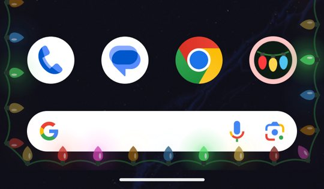

</div>

---

## Inhoud

1. [Wat is het?](#-wat-is-het)
2. [Installeren](#-installeren)
3. [Eerste keer gebruiken](#-eerste-keer-gebruiken)
4. [Functies](#-functies)
   - [Lampjes om de rand van je scherm](#-lampjes-om-de-rand-van-je-scherm)
   - [Kerstbomen](#-kerstbomen)
   - [Haarden](#-haarden)
   - [Interactieve scènes](#-interactieve-scènes)
   - [Eigen scène maken](#-eigen-scène-maken)
   - [Soorten lampjes](#-soorten-lampjes)
   - [Widgets](#-widgets)
   - [Live wallpaper](#-live-wallpaper)
   - [Geluid, muziek en microfoon](#-geluid-muziek-en-microfoon)
   - [Het ⋯-menu](#-het--menu)
   - [Speciale dagen](#-speciale-dagen)
5. [Bediening](#-bediening)
6. [Talen](#-talen)
7. [Rechten en privacy](#-rechten-en-privacy)
8. [Batterij en prestaties](#-batterij-en-prestaties)
9. [Veelgestelde vragen](#-veelgestelde-vragen)
10. [Bouwen uit de broncode](#️-bouwen-uit-de-broncode)
11. [Projectstructuur](#-projectstructuur)
12. [Techniek](#-techniek)
13. [Tests en CI](#-tests-en-ci)
14. [Bronnen en licenties](#-bronnen-en-licenties)

---

## 🎅 Wat is het?

Kerstlampjes is een Android-app die je telefoon verandert in een kerstversiering. **De hoofdzaak zijn de lampjes
op de achtergrond van je telefoon**: een lichtsnoer om de rand van je scherm dat ook boven je beginscherm blijft staan.
Alles daarna is bonus.

**Hoofdzaak**

- een **lichtsnoer langs de rand van je scherm**, dat óók boven je beginscherm, je iconen, widgets en andere apps blijft staan, met 5 effecten, 5 kleurenschema's, aan en uit via een snelle-instellingen-tegel, terug na een herstart en (in te stellen) reagerend op geluid;

**Bonus**

- **19 kerstbomen** (14 getekend, 5 op foto) plus je **eigen foto**, waar je zelf lampjes in hangt;
- **12 haarden** met echt deeltjesvuur of foto's van een knapperend haardvuur;
- **9 interactieve scènes**: sneeuwbol, adventskalender, adventskrans, kerstdorp met trein, slee, sneeuwpop, ijsbaan, kerststal en cadeautjes;
- een **eigen-scène-editor**: eigen achtergrond (ook je eigen foto), vuur in je eigen kleur, sneeuw, vuurwerk, stickers met eigen animaties, zelf getekende lichtsnoeren en delen met anderen;
- **8 soorten lampjes**, **3 widgets**, **live wallpaper**, **4 kerstliedjes**, een slaaptimer en favoriete looks;
- verrassingen op **speciale dagen** (Sinterklaas, kerstavond, oud en nieuw, Driekoningen …);
- **6 talen**: Nederlands, Engels, Duits, Frans, Spaans en Chinees.

Alles is getekend en gesynthetiseerd in de app zelf (Canvas, geen game-engine, geen AndroidX). De enige
afbeeldingen zijn de foto's van echte bomen en haarden, uit Wikimedia Commons ([bronnen](#-bronnen-en-licenties)).
Er zijn **geen advertenties en geen accounts**. Internet is alleen nodig als je zelf op *Controleren op updates* tikt.

| | |
|---|---|
| Pakketnaam | `nl.kerstlampjes.app` |
| Versie | 2.3 (versionCode 5) |
| Android | 8.0 (API 26) of nieuwer |
| Taal | Kotlin |
| Grootte | circa 3 MB |

---

## 📲 Installeren

### Optie 1: de APK van GitHub (aanbevolen)

1. Ga op je telefoon naar de [release v2.3](https://github.com/ericbruggema/kerstlampjes/releases/tag/v2.3).
   2. Download **`Kerstlampjes-2.3.apk`**.
3. Open het gedownloade bestand. Vraagt Android om toestemming voor *installeren uit onbekende bronnen*, sta dat dan toe voor je browser of bestandsbeheer.
4. Tik op **Installeren** en daarna op **Openen**.

> **Bijwerken van een oudere versie?** De release is ondertekend met een eigen sleutel. Staat er een versie
> met een andere handtekening op je telefoon (bijvoorbeeld een debug-build), verwijder die dan eerst. Je
> instellingen gaan dan verloren.

### Optie 2: de APK in de repository

Dezelfde ondertekende APK staat ook in de repo: [`website/Kerstlampjes.apk`](website/Kerstlampjes.apk).

### Optie 3: zelf bouwen

Zie [Bouwen uit de broncode](#️-bouwen-uit-de-broncode).

---

## 🚀 Eerste keer gebruiken

1. **Open de app.** Je ziet het instellingenscherm van de lampjes om de rand: effect, kleuren, snelheid, helderheid, uiterlijk en pasvorm.
2. **Tik op "Lampjes aanzetten".** De app vraagt eenmalig om toestemming om *boven andere apps te tekenen*. Zet die aan.
   Ga daarna terug: de lampjes lopen nu langs de rand van je scherm, ook als je naar je beginscherm gaat.
3. **Tik op "🎄 Bouw je kerstboom"** om de boom-, haard- en scèneweergave te openen. Swipe naar links of rechts om tussen bomen, haarden en scènes te wisselen.
4. **Tik op de boom** om een lampje te hangen. Tik op een lampje om de kleur te veranderen. Houd een lampje ingedrukt om het te verwijderen.
5. **Open het ⋯-menu** voor geluid, muziek, widgets, favorieten, slaaptimer, taal en meer.

<table>
<tr>
<td align="center">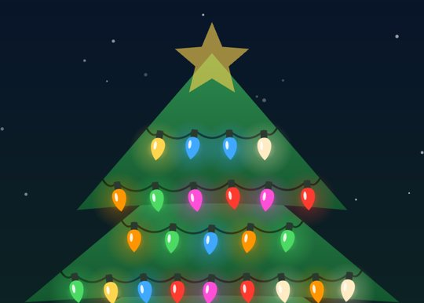<br><sub>Klassieke lampjes</sub></td>
<td align="center">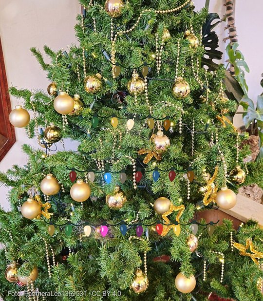<br><sub>Echte boom met lampjes</sub></td>
<td align="center">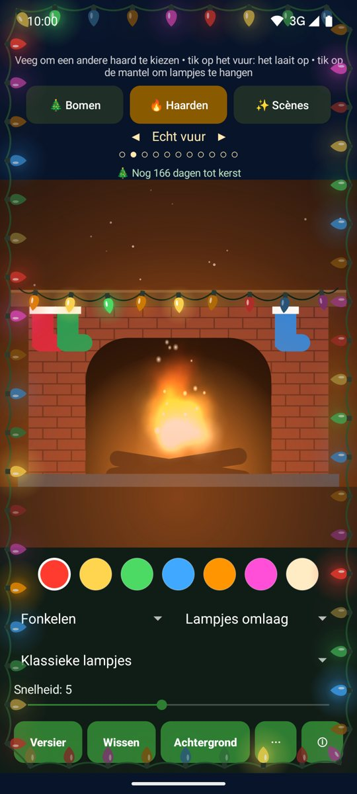<br><sub>Haard met echt vuur</sub></td>
<td align="center">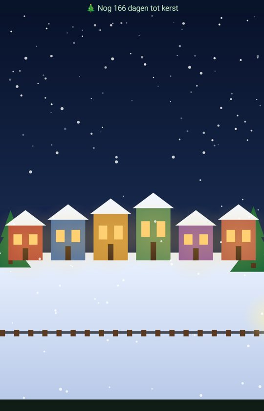<br><sub>Kerstdorp</sub></td>
</tr>
</table>

---

## ✨ Functies

### 💡 Lampjes om de rand van je scherm

Een geanimeerd lichtsnoer volgt de rand en de afgeronde hoeken van je scherm. Aanrakingen gaan gewoon door
naar de app eronder, dus het is geen scherm dat in de weg zit.

| Instelling | Mogelijkheden |
|---|---|
| **Effect** | Vast, fonkelen, om en om knipperen, lopend licht, kleurgolf en *Op de muziek* |
| **Kleuren** | 5 kleurenschema's |
| **Snelheid** | Traag tot snel |
| **Helderheid** | 30 tot 100% |
| **Uiterlijk** | Grootte van de lampjes, afstand ertussen en doorhang van de draad |
| **Pasvorm** | Afronding van de hoeken en afstand tot de rand, zodat het bij jouw scherm past |

- **Boven alles.** De lampjes staan boven je beginscherm, je iconen en je widgets en boven andere apps.
- **Aan en uit.** Via de knop in de app, via het ⋯-menu (*Lampjes om het scherm*) of via de **Snelle instellingen-tegel** in je meldingenpaneel.
- **Na een herstart.** Stonden de lampjes aan toen je de telefoon uitzette, dan komen ze vanzelf terug. Dit vereist dat de toestemming om boven andere apps te tekenen nog aanstaat.
- **Op de microfoon.** Zet in het ⋯-menu *Randlampjes reageren op geluid* aan (of kies het effect *Op de muziek*). Hoe harder het geluid, hoe meer lampjes oplichten. Bij stilte staan ze zacht aan. De app vraagt dan om toestemming voor de microfoon. Zie [Rechten en privacy](#-rechten-en-privacy).
- **Voorgrondmelding.** Android toont een melding zolang de lampjes aan staan. Dat is een eis van Android voor apps die op de achtergrond draaien.

<table>
<tr>
<td align="center"><br><sub>Boven het beginscherm, met dock en zoekbalk</sub></td>
<td align="center">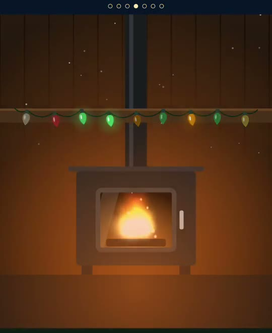<br><sub>Randlampjes rond een haard</sub></td>
<td align="center">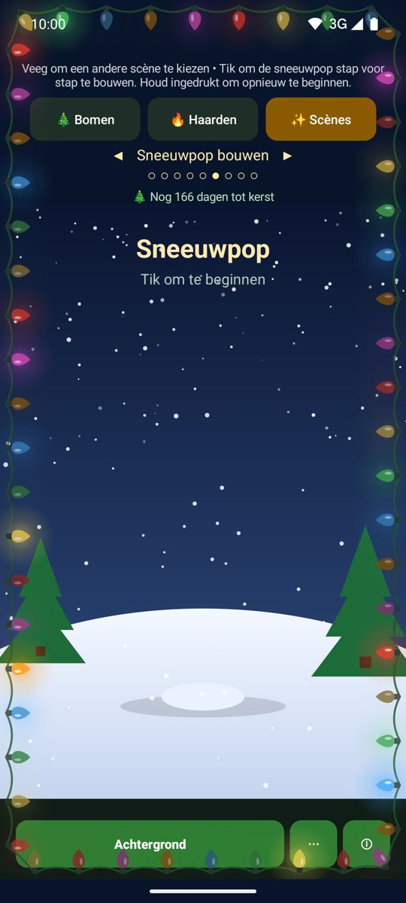<br><sub>Randlampjes rond de sneeuwpop</sub></td>
</tr>
</table>

### 🌲 Kerstbomen

19 bomen om tussen te swipen, elk met zijn eigen versiering, plus je eigen foto.

- **14 getekende bomen:** van klassiek en dennenboom tot neon, ijs en cartoon-3D.
- **5 echte kerstbomen op foto:** Capitool, binnenboom, spar in het park, stadsboom en lichtjesboom.
- **Je eigen foto:** kies een foto van je eigen boom of kamer en hang er lampjes overheen. Dit werkt ook als wallpaper.
- **Elke boom onthoudt zijn eigen lampjes.** Wissel je van boom en terug, dan hangen ze nog op dezelfde plek.
- **Lampsoort per boom,** of een mix van alle soorten.

<table>
<tr>
<td align="center"><br><sub>Capitool</sub></td>
<td align="center"><br><sub>Binnenboom</sub></td>
<td align="center">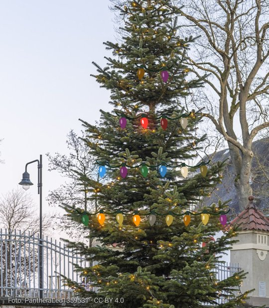<br><sub>Spar in het park</sub></td>
<td align="center">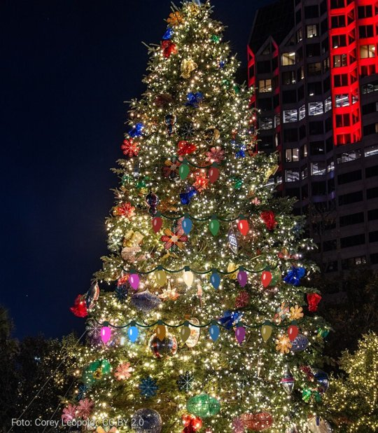<br><sub>Stadsboom</sub></td>
<td align="center">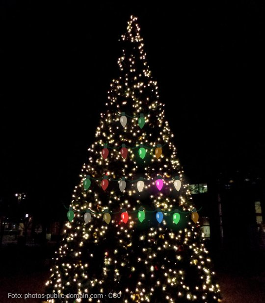<br><sub>Lichtjesboom</sub></td>
</tr>
</table>

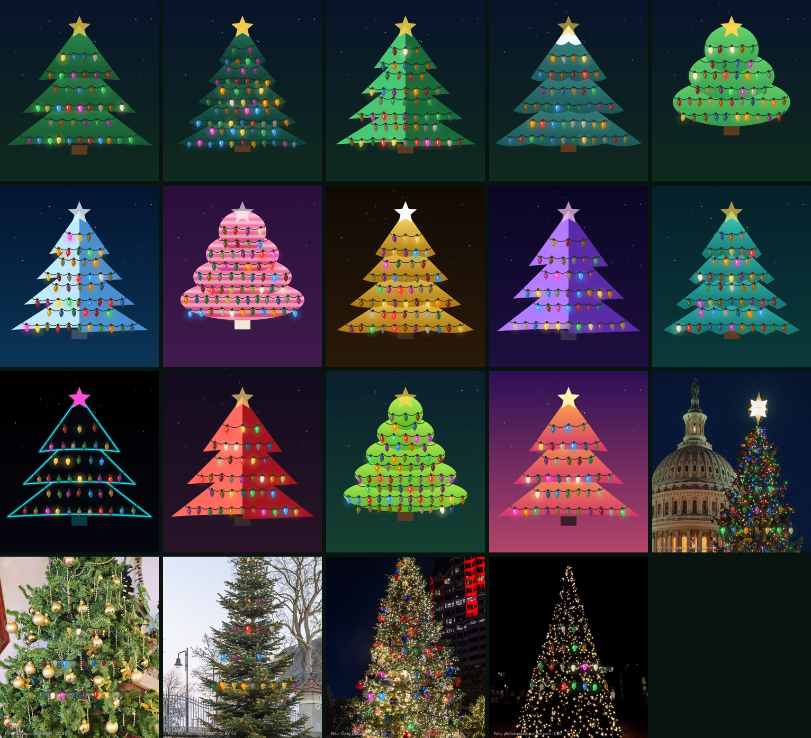

<sub>Alle getekende bomen naast elkaar.</sub>

### 🔥 Haarden

12 haarden met echt vuur. De 7 getekende haarden gebruiken honderden gloeiende deeltjes. De 5 foto-haarden
gebruiken een foto met een bewegend vuur eroverheen. Tik op het vuur en het laait op. Je eigen
lichtsnoer hangt langs de mantel of tussen de palen.

<table>
<tr>
<td align="center">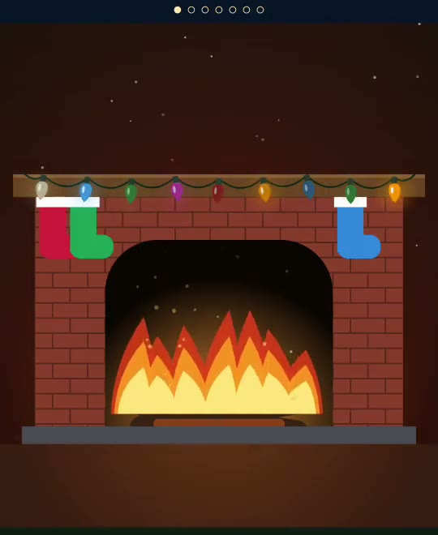<br><sub>Cartoon</sub></td>
<td align="center"><br><sub>Echt vuur</sub></td>
<td align="center">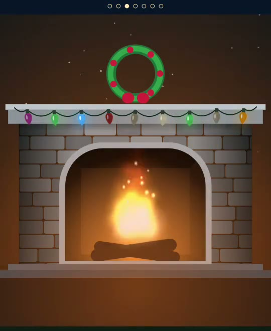<br><sub>Steen 3D</sub></td>
<td align="center"><br><sub>Houtkachel</sub></td>
</tr>
<tr>
<td align="center">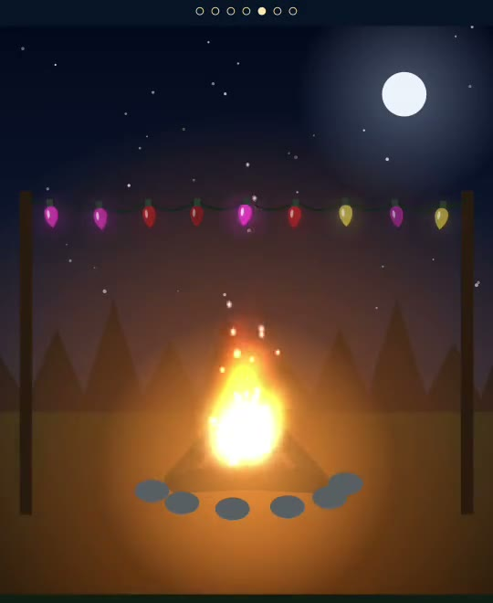<br><sub>Kampvuur</sub></td>
<td align="center">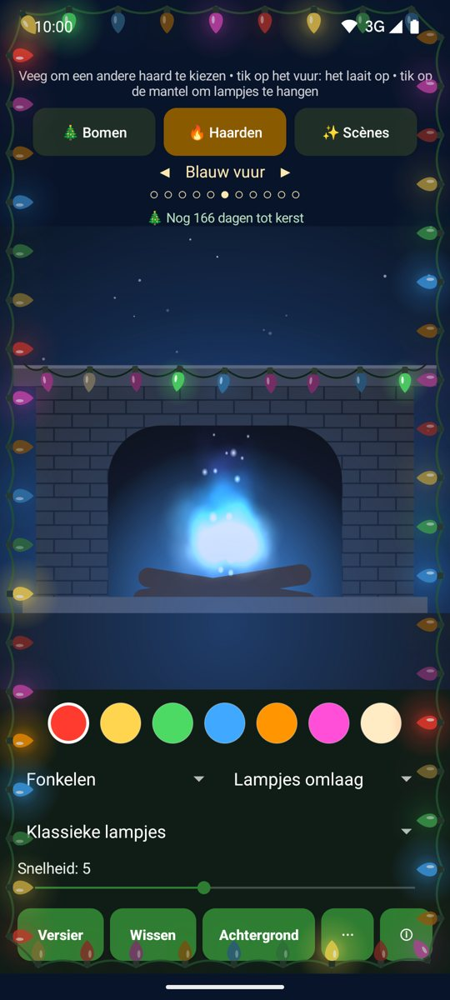<br><sub>Blauw vuur</sub></td>
<td align="center">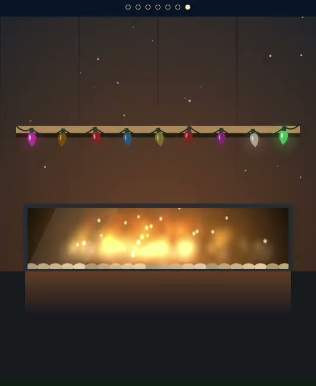<br><sub>Modern</sub></td>
<td></td>
</tr>
</table>

**Met echte foto's:**

<table>
<tr>
<td align="center">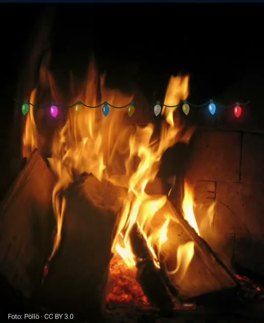<br><sub>Houtvuur</sub></td>
<td align="center">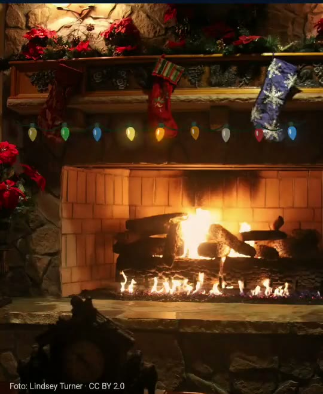<br><sub>Kerstkamer</sub></td>
<td align="center">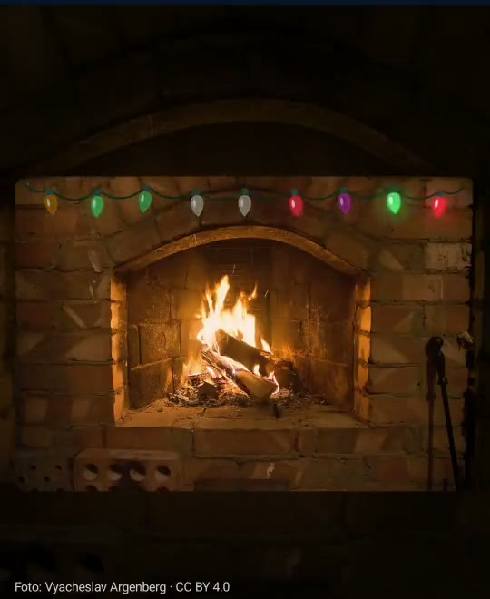<br><sub>Stenen haard</sub></td>
<td align="center">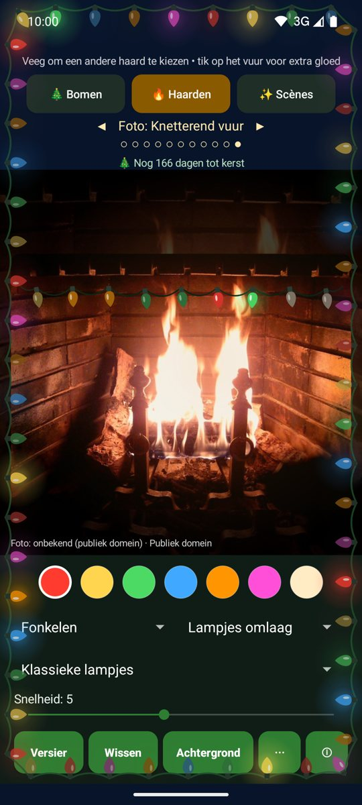<br><sub>Knetterend vuur</sub></td>
</tr>
</table>

### ✨ Interactieve scènes

Niet alleen kijken: tik, schud en bouw.

| Scène | Wat doe je? |
|---|---|
| **Sneeuwbol** | Schud je telefoon of tik: het gaat sneeuwen. |
| **Adventskalender** | Elke dag een luikje met een verrassing. |
| **Adventskrans** | Steek de kaarsjes aan, zondag voor zondag. |
| **Kerstdorp met trein** | Tik op huisjes voor licht, tik op de trein voor de toeter. Houd het spoor ingedrukt om de trein te laten stoppen. Tik op de lucht voor een sterretje. |
| **Slee van de kerstman** | Tik op de slee en het regent cadeautjes. Houd lang ingedrukt voor een turbo-rit. |
| **Sneeuwpop bouwen** | Tik en hij verschijnt stap voor stap. |
| **IJsbaan** | Tik op het ijs voor een nieuwe schaatser. Schaatsers draaien om elkaar heen. Tik op een schaatser en hij valt en glijdt van het ijs. |
| **Kerststal** | Tik op de sterrenhemel voor een wens. Tik op Maria, Jozef, de koningen, de os of de ezel en ze zeggen iets. |
| **Cadeautjes** | Eigen berichtjes die pas op een gekozen dag open mogen. |

<table>
<tr>
<td align="center">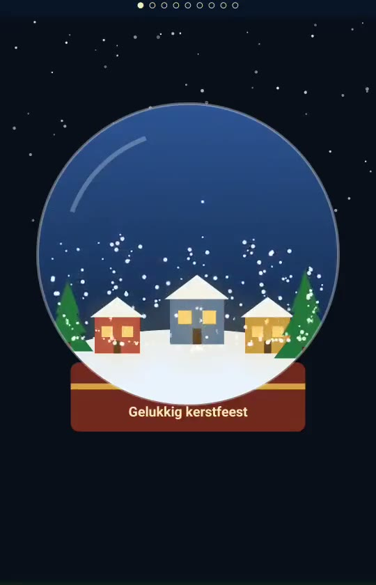<br><sub>Sneeuwbol</sub></td>
<td align="center">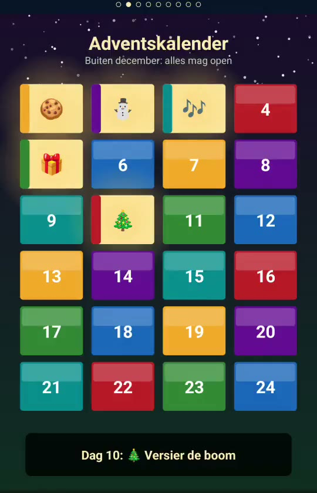<br><sub>Adventskalender</sub></td>
<td align="center">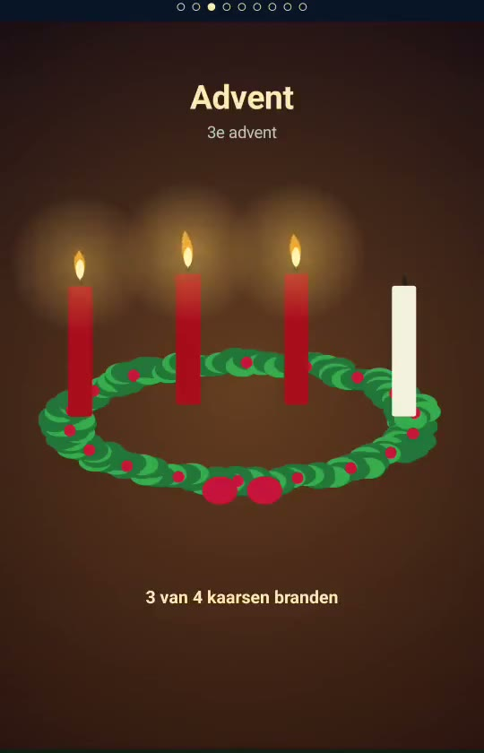<br><sub>Adventskrans</sub></td>
<td align="center"><br><sub>Kerstdorp</sub></td>
<td align="center">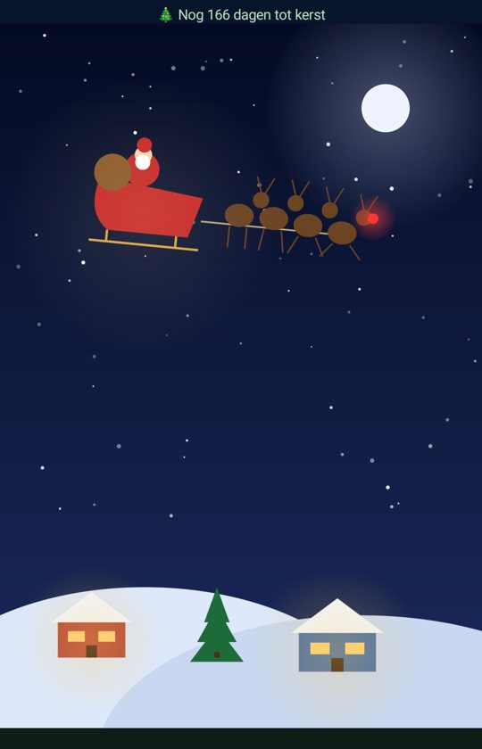<br><sub>Slee</sub></td>
</tr>
<tr>
<td align="center"><br><sub>Sneeuwpop</sub></td>
<td align="center">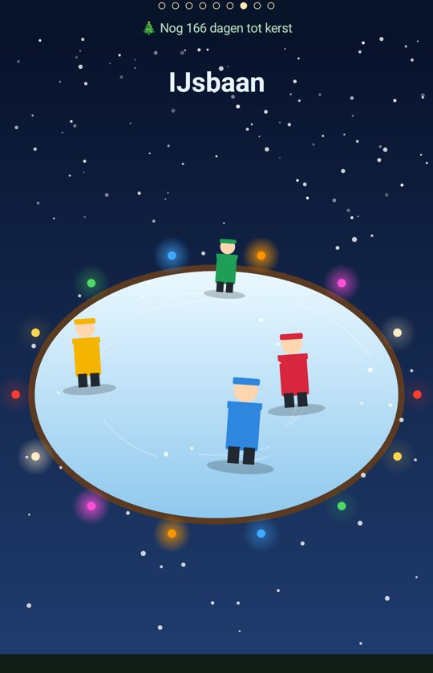<br><sub>IJsbaan</sub></td>
<td align="center">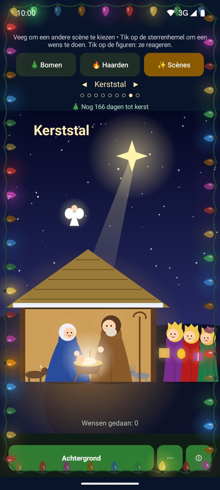<br><sub>Kerststal</sub></td>
<td align="center">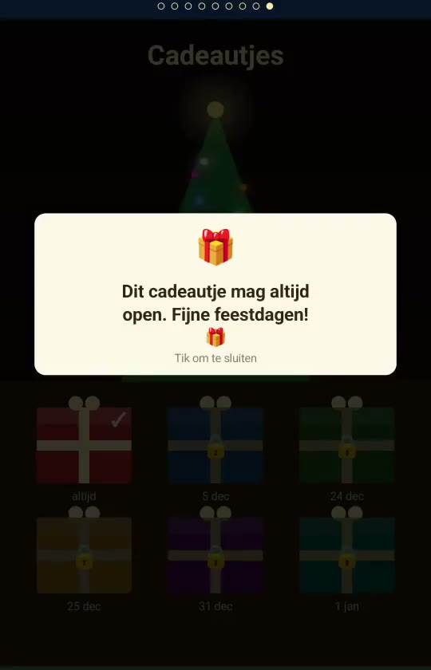<br><sub>Cadeautjes</sub></td>
<td></td>
</tr>
</table>

<table>
<tr>
<td align="center">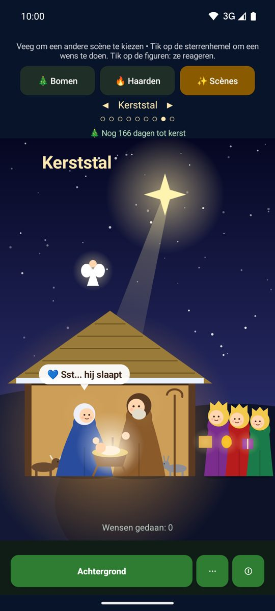<br><sub>De kerststal reageert op een tik</sub></td>
<td align="center">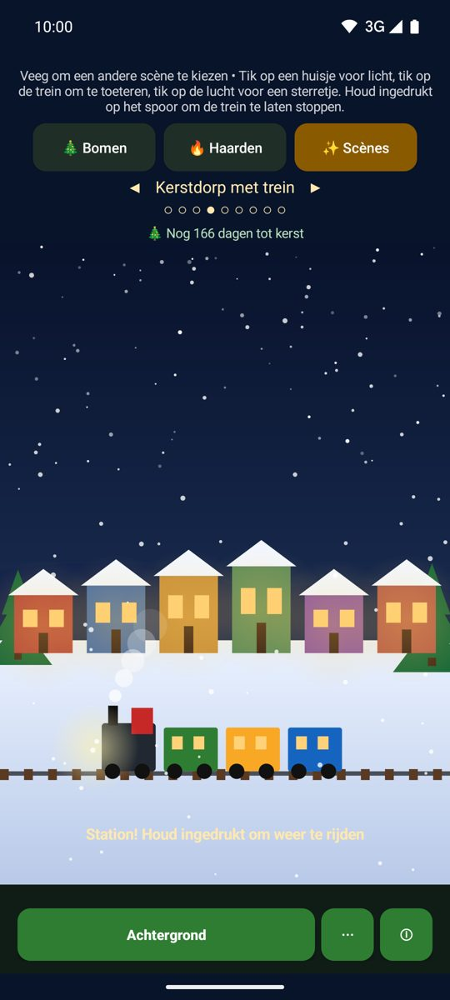<br><sub>De trein laten stoppen</sub></td>
</tr>
</table>

### 🎨 Eigen scène maken

Je bouwt je eigen kerstscène, precies zoals jij hem wilt. Open **⋯ → 🎨 Eigen scène maken**. Je ziet
bovenaan precies wat de scène later laat zien en onderaan vijf tabbladen.

| Tabblad | Wat kun je? |
|---|---|
| 🖼️ **Achtergrond** | Kies uit acht kleurverlopen of gebruik je **eigen foto**. Zet een sneeuwgrond aan of uit. |
| ✨ **Effecten** | Sneeuw, vallende dingen (cadeautjes, sterren, hartjes …), confetti, fonkelende sterren, vuurwerk, vallende sterren, een zachte gloed en **vuur**. Elk effect heeft eigen schuifjes (hoeveelheid, snelheid, grootte) en kleur. |
| 🎅 **Stickers** | 32 plaatjes (kerstboom, kerstman, sneeuwpop, slee, trein …). Sleep ze, maak ze groter of kleiner en draai ze. |
| 💡 **Lampjes** | **Teken met je vinger een lichtsnoer** langs een raam, dak of boom, of kies *Bovenkant*, *Boog* of *Rondom*. Kies per snoer de soort lampjes, de kleuren en het effect. |
| 💾 **Meer** | Naam, nieuwe scène, dupliceren, al je scènes, **delen**, plakken en verwijderen. |

<table>
<tr>
<td align="center">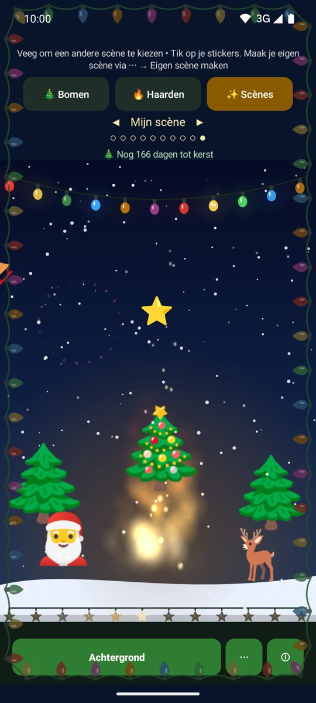<br><sub>Een eigen scène</sub></td>
<td align="center">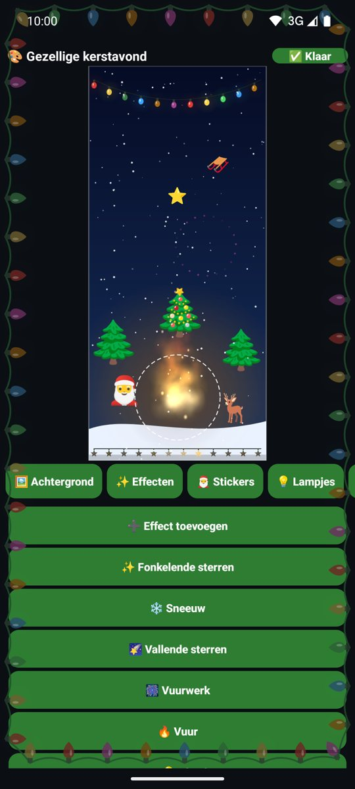<br><sub>Effecten en vuur</sub></td>
<td align="center">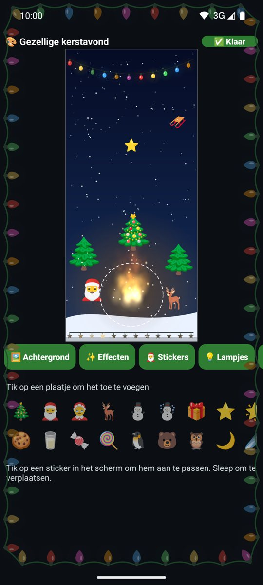<br><sub>Stickers</sub></td>
<td align="center">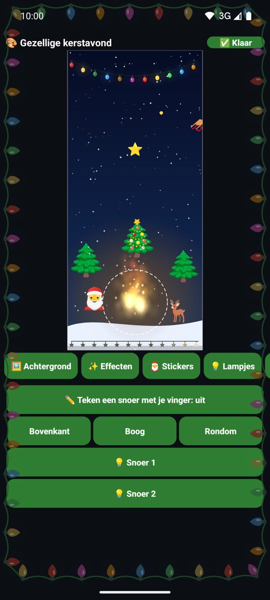<br><sub>Lichtsnoeren tekenen</sub></td>
</tr>
</table>

**Vuur in je eigen kleur.** Zet het vuur waar je wilt en kies oranje, blauw, groen, paars of wit. Stel hoogte,
breedte en snelheid in. Tik op het vuur in de scène en het laait op.

**Eigen animaties.** Elke sticker heeft een animatie en een reactie op een tik:

| Animatie | Reactie bij een tik |
|---|---|
| Stil, zweven, zwaaien, pulseren, knipperen, hupsen, ronddraaien, voorbijrijden, rondjes draaien | Niets, hupsen, sterretjes, draaien, belletje of **zeg iets** (een tekstballon met je eigen tekst) |

**Opslaan en gebruiken.** Alles wordt automatisch bewaard. Je ziet je scène terug als scène **Mijn scène** (de
laatste in de rij van scènes). Je kunt hem als **live wallpaper** instellen en in je favorieten bewaren. Je kunt
meerdere scènes bewaren en tussen ze wisselen via *Meer → Mijn scènes*.

**Delen.** Kies *Meer → Delen* en stuur de tekst via WhatsApp, e-mail of een andere app. De ontvanger kopieert de
tekst en kiest in de editor *Meer → Plakken*. Een eigen foto als achtergrond wordt niet meegestuurd.

### 💡 Soorten lampjes

Kies onder de boom uit acht soorten, of een **mix** van alles. Je kunt de keuze per boom of haard bewaren,
of laten gelden voor alles, inclusief je wallpaper.

<table>
<tr>
<td align="center"><br><sub>Klassiek</sub></td>
<td align="center">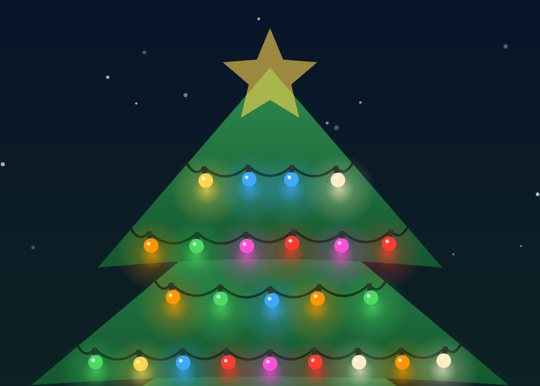<br><sub>Mini-ledjes</sub></td>
<td align="center">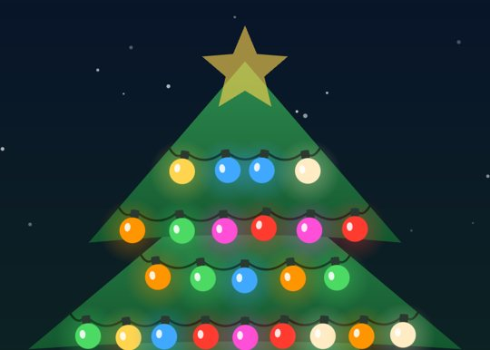<br><sub>Glazen bollen</sub></td>
<td align="center">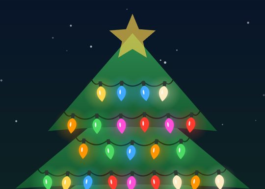<br><sub>Vlammetjes</sub></td>
</tr>
<tr>
<td align="center">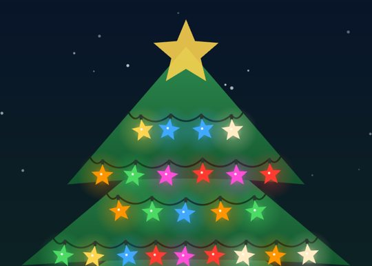<br><sub>Sterretjes</sub></td>
<td align="center">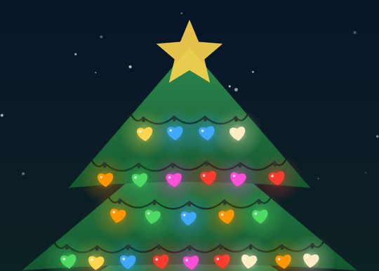<br><sub>Hartjes</sub></td>
<td align="center">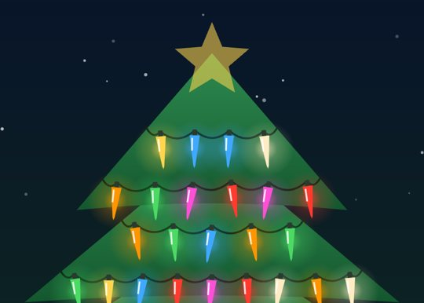<br><sub>IJspegels</sub></td>
<td align="center">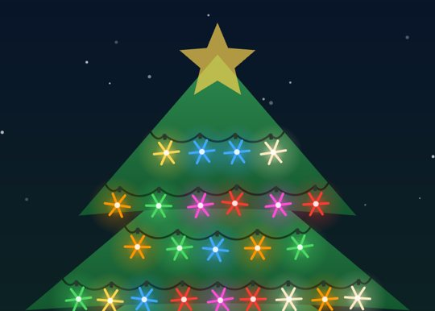<br><sub>Sneeuwvlokken</sub></td>
</tr>
</table>

### 📱 Widgets

Drie widgets voor je beginscherm. Houd een lege plek op je beginscherm ingedrukt, kies *Widgets* en zoek *Kerstlampjes*.

| Widget | Wat zie je? |
|---|---|
| **Aftellen tot kerst** | Het aantal dagen tot Kerstmis, met een tekst op de feestdagen zelf. |
| **Scène van vandaag** | De scène die bij de datum van vandaag past (advent, kerststal, cadeautjes …). Tik om de app op die scène te openen. |
| **Kerstboom met lampjes** | Je eigen boom met jouw lampjes, met afgeronde hoeken. Tik om de app te openen. |

De boom-widget ververst alleen als je boom echt veranderd is, zodat hij je batterij niet belast.

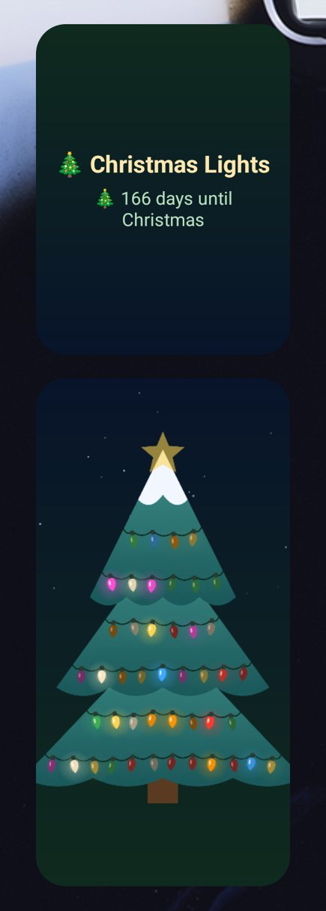

### 🖼️ Live wallpaper

Kies in de app een boom, haard of scène en zet hem als **live wallpaper**. Je ziet dan elke keer als je naar je
beginscherm gaat bijvoorbeeld het vuur of de rijdende trein, met jouw lampjes erop.

1. Kies in de app de gewenste boom, haard of scène.
2. Tik op de knop **Achtergrond** onder de boom.
3. Bevestig in het scherm van Android.

<table>
<tr>
<td align="center">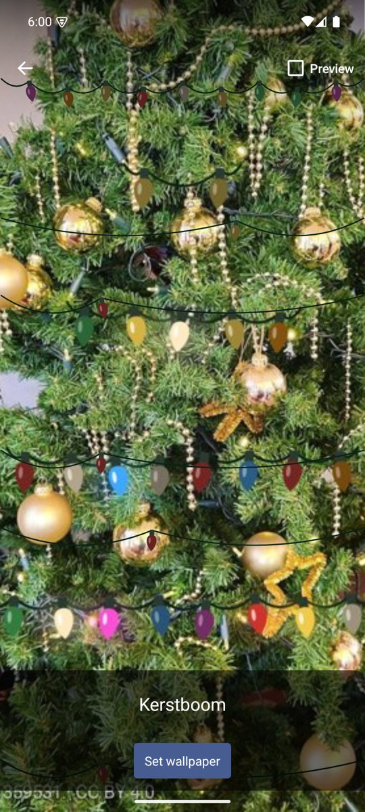<br><sub>Echte boom als wallpaper</sub></td>
<td align="center">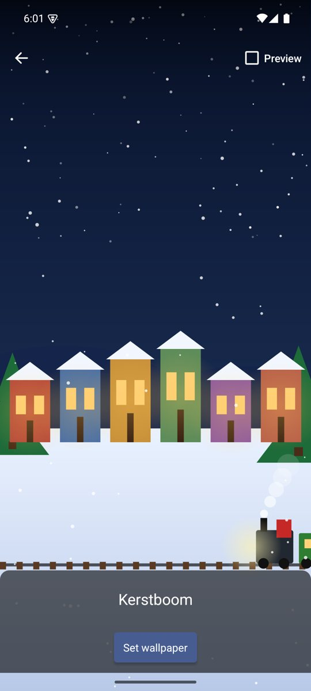<br><sub>Kerstdorp als wallpaper</sub></td>
<td align="center">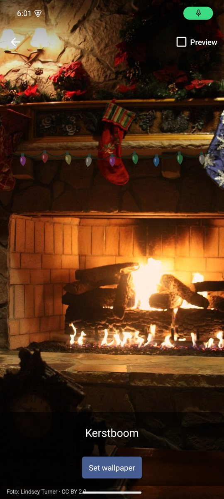<br><sub>Foto-haard als wallpaper</sub></td>
</tr>
</table>

### 🔊 Geluid, muziek en microfoon

Alle geluid wordt **in de app zelf gesynthetiseerd**. Er zijn geen audiobestanden.

- **Haardvuur:** knetterend vuur bij de haarden.
- **Belletjes** bij een tik, en een **speeldoos-melodie** in de scènes.
- **Vier kerstliedjes:** *Jingle Bells*, *Stille nacht*, *We wish you a merry Christmas* en *Deck the halls*, elk met een eigen tempo, een speeldoos-klank en een lichte echo. Kies het liedje via *Muziek* in het ⋯-menu.
- **Op de muziek:** een lampjes-effect waarbij de lampjes meebewegen met het geluid. Het volgt zowel de ingebouwde liedjes als de microfoon.

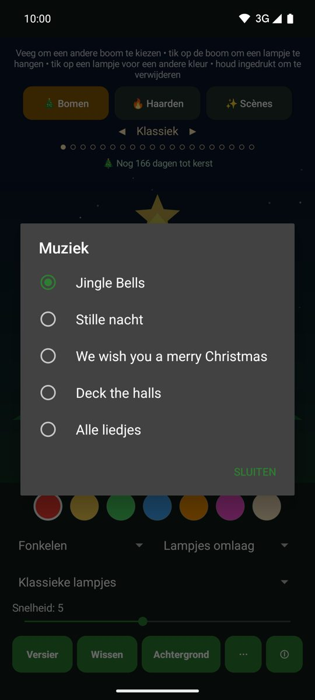

### ⋯ Het ⋯-menu

| Item | Wat doet het? |
|---|---|
| 💡 **Lampjes om het scherm** | Zet de randlampjes aan of uit. |
| 🎤 **Randlampjes reageren op geluid** | De randlampjes bewegen op het geluid van de microfoon. |
| 🔊 **Geluid** | Haardvuur, belletjes en melodieën aan of uit. |
| 🎵 **Muziek** | Kies een van de vier kerstliedjes. |
| 📅 **Automatisch naar scène van de dag** | In het seizoen opent de app op de scène van vandaag. |
| 🔔 **Dagelijkse melding** | Elke dag om 18:00 een melding met het aftellen. |
| 🎁 **Ga naar scène van vandaag** | Direct naar de scène die bij de datum past. |
| ⭐ **Favoriete looks** | Sla boom of haard met lampjes, effect en soort lampjes op onder een eigen naam. |
| 😴 **Slaaptimer** | 15 minuten tot 2 uur: de lampjes dimmen rustig en gaan uit. |
| 🔋 **Beeldsnelheid** | Normaal (30 fps), zuinig (15 fps) of automatisch. |
| 🖼️ **Eigen foto** | Gebruik een eigen foto als achtergrond. |
| 🔄 **Controleren op updates** | Kijkt op GitHub of er een nieuwere versie is en opent de downloadpagina. |
| 🌍 **Taal** | Automatisch, of kies zelf een van de zes talen. |

<table>
<tr>
<td align="center">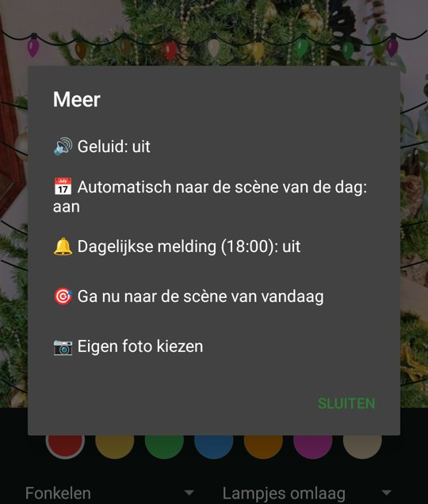<br><sub>Het ⋯-menu</sub></td>
<td align="center">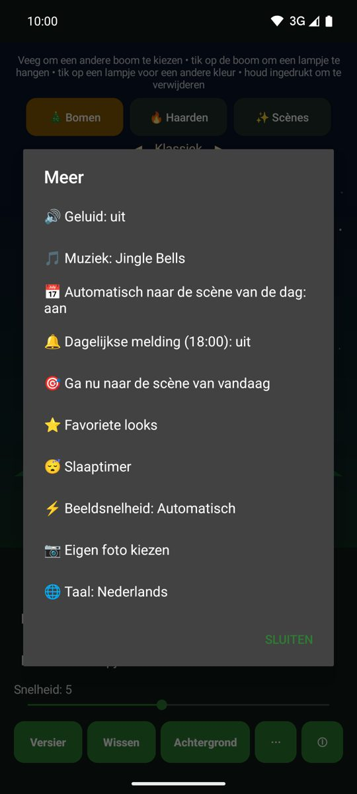<br><sub>Meer opties</sub></td>
<td align="center">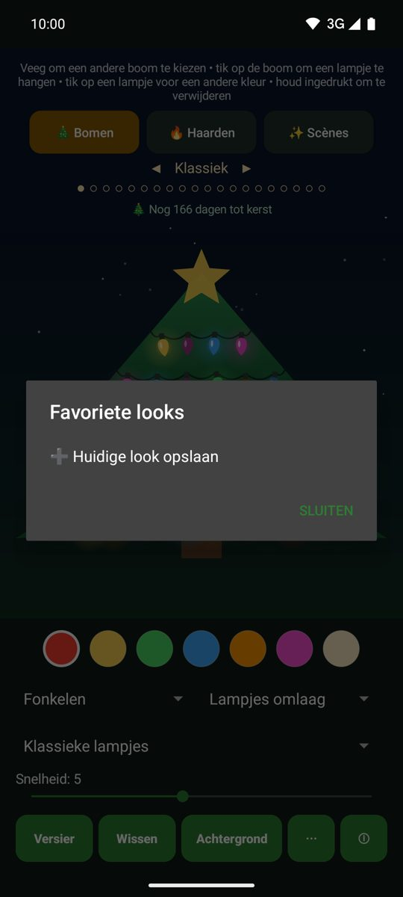<br><sub>Favoriete looks</sub></td>
<td align="center">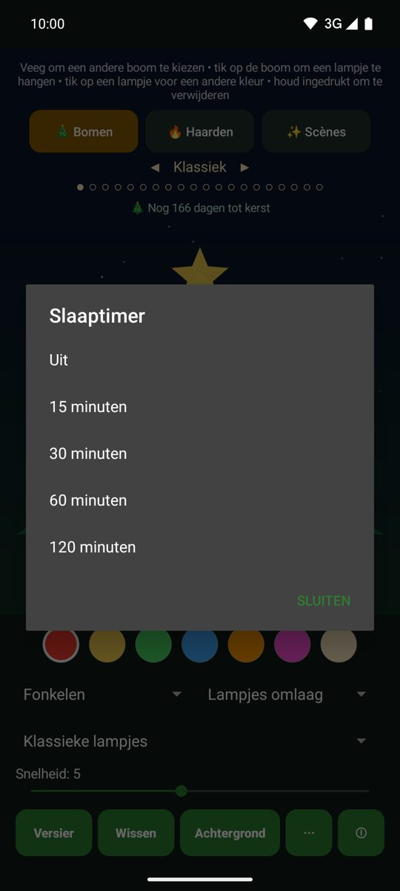<br><sub>Slaaptimer</sub></td>
</tr>
<tr>
<td align="center">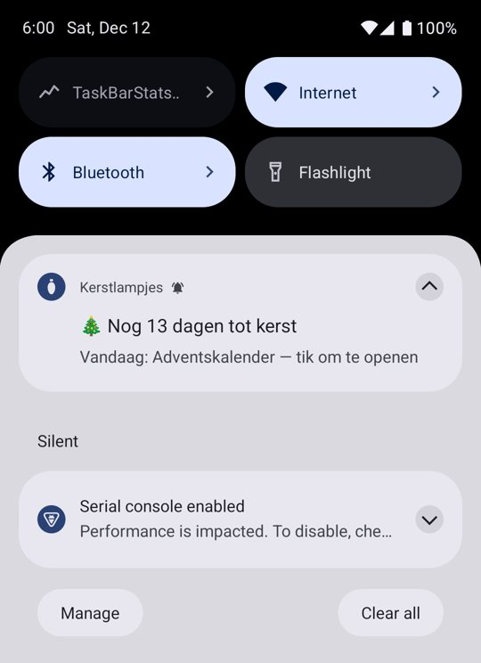<br><sub>Dagelijkse melding</sub></td>
<td align="center"><br><sub>Scène van de dag</sub></td>
<td align="center"><br><sub>Eigen foto</sub></td>
<td align="center"><br><sub>Taal kiezen</sub></td>
</tr>
</table>

### 📅 Speciale dagen

- **Scène van de dag:** van 15 november tot 6 januari openen de app, de widget en de melding op de scène die bij vandaag past: kerstdorp in november, de adventskrans op de adventszondagen, de adventskalender in december, kerststal en cadeautjes rond kerst.
- **Aftellen tot kerst:** bovenin het scherm van de boom en in de widget.
- **Verrassingen:** op een aantal bijzondere dagen gebeurt er iets in de app (Sinterklaas, kerstavond, eerste en tweede kerstdag, oudejaarsavond, nieuwjaar en Driekoningen). Kom op een speciale dag nog eens terug. 👀

<table>
<tr>
<td align="center"><br><sub>Sinterklaas</sub></td>
<td align="center"><br><sub>Kerstavond</sub></td>
<td align="center"><br><sub>Eerste kerstdag</sub></td>
<td align="center"><br><sub>Oudejaarsavond</sub></td>
<td align="center"><br><sub>Driekoningen</sub></td>
</tr>
</table>

---

## 👆 Bediening

| Gebaar | Waar | Effect |
|---|---|---|
| Swipe links/rechts | Boom, haard of scène | Volgende of vorige |
| Tik | Boom of haard | Lampje ophangen |
| Tik op een lampje | Boom of haard | Andere kleur |
| Lang indrukken op een lampje | Boom of haard | Lampje verwijderen |
| Tik | Vuur | Het vuur laait op |
| Schudden | Sneeuwbol | Het sneeuwt |
| Tik | Kerstdorp: huisje | Licht aan of uit |
| Tik | Kerstdorp: lucht | Sterretje |
| Lang indrukken op het spoor | Kerstdorp | Trein stopt of rijdt weer |
| Tik / lang indrukken | Slee | Cadeautjes / turbo |
| Tik | Ijsbaan | Nieuwe schaatser, of een schaatser valt |
| Tik op een figuur | Kerststal | De figuur zegt iets |

---

## 🌍 Talen

| Taal | Code |
|---|---|
| Nederlands | `nl` |
| English | `en` |
| Deutsch | `de` |
| Français | `fr` |
| Español | `es` |
| 中文 | `zh` |

De app volgt standaard de taal van je telefoon. Kies je zelf een taal via **⋯ → Taal**, dan geldt die voor de
hele app, de widgets en de melding. Staat je telefoon op een andere taal, dan is de app Engels.


---

## 🔐 Rechten en privacy

De app gebruikt internet **alleen** als jij in het ⋯-menu op *Controleren op updates* tikt. Dan wordt de naam van de nieuwste versie opgevraagd bij GitHub en wordt er niets van jou verstuurd. Verder verstuurt de app niets. Alles blijft op je telefoon.

| Recht | Waarvoor | Verplicht? |
|---|---|---|
| Boven andere apps tekenen (`SYSTEM_ALERT_WINDOW`) | De randlampjes boven het beginscherm en andere apps | Alleen voor de randlampjes |
| Voorgrondservice (`FOREGROUND_SERVICE`, `…_SPECIAL_USE`) | De randlampjes laten draaien op de achtergrond | Alleen voor de randlampjes |
| Microfoon (`RECORD_AUDIO`, `FOREGROUND_SERVICE_MICROPHONE`) | Lampjes die op geluid reageren | Nee, alleen als je dat effect kiest |
| Internet (`INTERNET`) | Alleen de updatecontrole in het ⋯-menu | Nee, alleen als je erop tikt |
| Meldingen (`POST_NOTIFICATIONS`) | Dagelijkse melding en de melding van de voorgrondservice | Nee |
| Opstarten (`RECEIVE_BOOT_COMPLETED`) | Randlampjes en melding terugzetten na een herstart | Nee |

- **Microfoon:** de app meet alleen het geluidsniveau, om de lampjes mee te laten bewegen. Er wordt niets opgenomen, opgeslagen of verstuurd. Android toont zelf de microfooniindicator zolang de microfoon in gebruik is.
- **Foto's:** een eigen foto wordt alleen lokaal in de app gebruikt.
- **Gegevens:** instellingen, lampjes en favorieten staan in de eigen opslag van de app (`SharedPreferences`). Verwijder je de app, dan zijn ze weg.

---

## 🔋 Batterij en prestaties

- De app tekent met Canvas. Statische delen (de boom) worden eenmalig in een bitmap bewaard.
- **Beeldsnelheid:** normaal 30 fps, *zuinig* 15 fps en *automatisch* schakelt naar 15 fps bij batterijbesparing of minder dan 20% batterij.
- **Op de achtergrond** wordt er niets getekend als de app niet zichtbaar is. De randlampjes met vast licht (*Vast*) blijven stilstaan en kosten geen frames.
- De **widgets** verversen alleen als er echt iets veranderd is.
- De **microfoon** verbruikt extra batterij. Daarom staat het standaard uit.
- Op de emulator ging de mediane framebouwtijd van circa 30 ms naar circa 23 ms bij de laatste optimalisaties. Echte metingen op een telefoon zijn nog niet gedaan.

---

## ❓ Veelgestelde vragen

**De lampjes verdwijnen na een tijdje.**
Sommige telefoonmerken (Xiaomi, Huawei, Samsung, OnePlus …) stoppen achtergrond-apps agressief. Zet in de
batterij-instellingen *batterijoptimalisatie* uit voor Kerstlampjes en sta *automatisch starten* toe.

**Ik zie geen lampjes boven mijn beginscherm.**
Controleer in *Instellingen → Apps → Kerstlampjes → Boven andere apps weergeven* of de toestemming aanstaat.

**De lampjes komen na een herstart niet terug.**
De app moet nog toestemming hebben om boven andere apps te tekenen, en de lampjes moeten aan hebben gestaan
vóór de herstart. Sommige fabrikanten blokkeren opstart-ontvangers; sta *automatisch starten* toe.

**De widget toont niets of is leeg.**
Verwijder de widget en voeg hem opnieuw toe. De boom-widget heeft de app minstens één keer geopend nodig.

**De installatie lukt niet (“app niet geïnstalleerd”).**
Staat er al een versie met een andere handtekening, verwijder die dan eerst. Controleer ook of je telefoon
Android 8.0 of nieuwer heeft.

**Werkt de app zonder internet?**
Ja, volledig. Internet wordt alleen gebruikt voor de updatecontrole die je zelf start.

**Kan ik de app in de Play Store krijgen?**
Nog niet. De APK is bedoeld om zelf te installeren.

---

## 🛠️ Bouwen uit de broncode

### Vereisten

- JDK 17
- Android SDK (platform 34/35 en build-tools; `ANDROID_HOME` ingesteld)
- Geen Android Studio nodig: de Gradle wrapper doet alles

### Debug-build en tests

```bash
cd Kerstlampjes
./gradlew testDebugUnitTest assembleDebug
```

De APK komt in `Kerstlampjes/app/build/outputs/apk/debug/app-debug.apk`.

Installeren op een toestel of emulator:

```bash
adb install -r app/build/outputs/apk/debug/app-debug.apk
```

### Release (ondertekend)

1. Maak een keystore:

   ```bash
   keytool -genkeypair -keystore release.keystore -alias kerstlampjes -keyalg RSA -keysize 2048 -validity 10000
   ```
2. Maak `Kerstlampjes/keystore.properties` (staat in `.gitignore`):

   ```
   storeFile=release.keystore
   storePassword=...
   keyAlias=kerstlampjes
   keyPassword=...
   ```
3. Bouw de release:

   ```bash
   ./gradlew assembleRelease
   ```

   Resultaat: `app/build/outputs/apk/release/app-release.apk`. De release-build gebruikt minify en resource-shrinking.

Bewaar de keystore goed: zonder dezelfde sleutel kun je een geïnstalleerde app niet meer bijwerken.
De keystore en de wachtwoorden horen **niet** in git.

### Een release op GitHub zetten

```bash
gh release create v2.3 app-release.apk --title "Kerstlampjes 2.3" --notes "..."
```

---

## 🗂️ Projectstructuur

```
KerstApp/
├── Kerstlampjes/                  Android-project (Gradle, Kotlin)
│   └── app/src/
│       ├── main/java/nl/kerstlampjes/app/
│       │   ├── MainActivity.kt        Instellingen van de randlampjes
│       │   ├── TreeActivity.kt        Boom/haard/scène-scherm, pickers en ⋯-menu
│       │   ├── TreeRenderer.kt        Tekenen van bomen, lampjes, snoer, TreeStore
│       │   ├── Hearths.kt             Haarden en deeltjesvuur
│       │   ├── Scenes.kt              De 9 interactieve scènes
│       │   ├── MyScene.kt             Eigen scène: recept, opslag, tekenen van effecten, stickers en lichtsnoeren
│       │   ├── SceneEditorActivity.kt Editor voor eigen scènes
│       │   ├── LightsService.kt       Voorgrondservice voor de randlampjes
│       │   ├── LightsView.kt          Overlay-view met het lichtsnoer
│       │   ├── TreeWallpaperService.kt Live wallpaper
│       │   ├── Widgets.kt             De drie widgets
│       │   ├── Extras.kt              Geluid, muziek, kalender, melding, opstarten
│       │   ├── Tr.kt / Translations.kt Vertalingen
│       │   ├── Perf.kt                Beeldsnelheid en batterij
│       │   ├── Prefs.kt               Instellingen
│       │   └── Credits.kt             Foto-bronnen in de app
│       ├── main/res/                  Layouts, widgets, strings (nl/en/de/fr/es/zh)
│       └── test/                      Unit tests
├── website/                       Statische website
│   ├── index.html, style.css      Hoofdpagina
│   ├── eggs.js + verborgen pagina Speciale-dagenverrassingen
│   ├── media/                     Screenshots en korte video's
│   └── Kerstlampjes.apk           Ondertekende release-APK
├── CREDITS.md                     Bronnen en licenties van de foto's
├── .github/workflows/android.yml  CI
└── README.md
```

---

## 🧩 Techniek

- **Taal en platform:** Kotlin, `minSdk 26`, geen AndroidX. Alles is gewone Android SDK.
- **Tekenen:** één gedeelde `TreeRenderer` tekent voor het boomscherm, de widget en de live wallpaper.
  `SceneHost` beheert de scènes en `HearthPainter` de haarden.
- **Randlampjes:** een `TYPE_APPLICATION_OVERLAY`-venster in een voorgrondservice (`specialUse`, met `microphone` erbij als het muziekeffect aanstaat). Het venster is niet aanraakbaar, dus aanrakingen gaan door.
- **Widgets:** `AppWidgetProvider`s met `RemoteViews`. De boom-widget rendert een bitmap en schaalt die.
- **Opslag:** `SharedPreferences` met de naam `kerstlampjes`. Lampjes per boom staan onder een sleutel met de naam van de boom, zodat de volgorde van bomen later kan veranderen zonder je lampjes te verliezen.
- **Geluid:** liedjes en effecten worden gesynthetiseerd; `AudioLevel` combineert microfoon en synthesizer. De microfoon wordt alleen aangezet als een onderdeel (app, wallpaper of randlampjes) hem nodig heeft.
- **Vertalingen:** Nederlandse tekst is de sleutel (`Tr.t("…")`, `Tr.f(fmt, …)`). `Translations.kt` bevat de vijf andere talen.
- **Prestaties:** cache voor de boomlaag, hergebruik van shaders en paden, geen tekenwerk op de achtergrond, `Perf.frameDelay` voor 30/15 fps.
- **Release:** minify en shrink met `proguard-rules.pro`, ondertekening uit `keystore.properties`.

### Vertalen

Teksten staan als Nederlandse sleutel in de code (`Tr.t("…")`). De vertalingen staan in `Translations.kt`.
Voeg je een nieuwe tekst toe, vul dan de vijf vertalingen in. De test `TranslationsTest` controleert dat
alles in alle talen is vertaald en dat de plaatsaanduidingen (`%d`, `%s`) overeenkomen.

---

## ✅ Tests en CI

- **Unit tests** (`./gradlew testDebugUnitTest`):
  - `TranslationsTest`: elke sleutel is in alle talen vertaald, met dezelfde plaatsaanduidingen.
  - `CalendarTest`: de scène van de dag klopt voor adventszondagen, kerst, oud en nieuw en de overige data.
- **Lint:** `./gradlew lintDebug`.
- **GitHub Actions** (`.github/workflows/android.yml`): bij elke push naar `main` en bij elke pull request draaien lint, unit tests en een debug- en release-build. De APK's worden als artifact bewaard.

Wat **niet** is getest: het gedrag op een echte telefoon (batterij, echte microfoon, geluid van de liedjes) en het
terugkomen van de randlampjes na een echte herstart.

---

## 🤝 Open source en gebruik

Kerstlampjes is **open source en vrij voor iedereen te gebruiken** onder de [MIT-licentie](LICENSE). Kopiëren,
aanpassen, delen en zelfs gebruiken in je eigen app mag. De code staat hier: https://github.com/ericbruggema/kerstlampjes.

**Graag een vermelding.** Gebruik je code of ideeën uit dit project (bijvoorbeeld de eigen-scène-editor, de
randlampjes of het deeltjesvuur)? Zet dan een verwijzing naar https://github.com/ericbruggema/kerstlampjes in je app, README of op je website. De
MIT-licentie vraagt in elk geval om het behouden van de copyright-vermelding in [`LICENSE`](LICENSE). Een korte
tekst als "Gebaseerd op Kerstlampjes, https://github.com/ericbruggema/kerstlampjes" is genoeg.

Verbeteringen, vertalingen en ideeën zijn welkom via [issues en pull requests](https://github.com/ericbruggema/kerstlampjes/issues). De foto's in de
app hebben hun eigen licentie, zie hieronder.

---

## 📄 Bronnen en licenties

De foto's van echte bomen en haarden komen van **Wikimedia Commons** (opgehaald op 14 oktober 2026). Ze zijn
verkleind en bijgesneden. De volledige lijst met auteurs en licenties staat in [`CREDITS.md`](CREDITS.md) en
in de app onder *Bronnen*.

| Foto | Auteur | Licentie |
|---|---|---|
| Fire burning in a fireplace | Pöllö | CC BY 3.0 |
| Cozy Christmas Fireplace with stockings | Lindsey Turner | CC BY 2.0 |
| Fireplace, Wood fire, Rostov-on-Don | Vyacheslav Argenberg | CC BY 4.0 |
| Fireplace Burning | onbekend | Publiek domein |
| 2020 Capitol Christmas Tree with Lights | USCapitol | Publiek domein |
| Weihnachtsbaum im China Garten | PantheraLeo1359531 | CC BY 4.0 |
| Weihnachtsbaum am Lorenzpark | PantheraLeo1359531 | CC BY 4.0 |
| Christmas Tree in the Park | Corey Leopold | CC BY 2.0 |
| White Christmas Tree Lights at Night | photos-public-domain.com | CC0 |

Muziek en geluid zijn zelf gesynthetiseerd; de liedjes zijn traditioneel en vrij van rechten.

---

<div align="center">

Gemaakt met veel lampjes. 🎄✨

</div>
